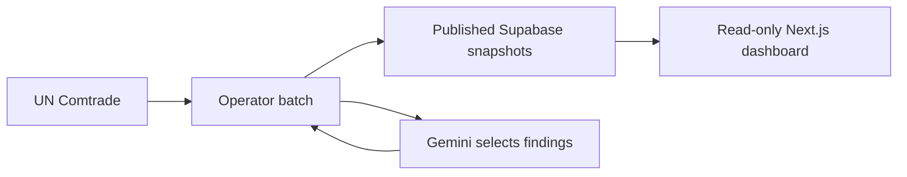

# Global Trade Intelligence

Compare destination markets for Indonesian export products. The homepage lists
every supported product. Choose one to see all screened markets, then open a
market for annual import history and supplier countries.

The shared dataset covers **12 HS 2022 products, 10 markets and 2022–2025**.
The cohort was published on **24 November 2026 (UTC)**. Each ranking displays its
own publication date. Trade years show when imports were reported, while the
publication date shows when the dashboard snapshot was prepared.
Source: UN Comtrade.

## Run the app

1. Install dependencies with `npm ci`.
2. Copy `.env.example` to `.env.local`. For the dashboard, configure the
   Supabase project URL and public reader key. Keep writer and provider
   credentials in the operator environment.
3. Run `npm run dev` and open [localhost:3000](http://localhost:3000).

Open **Product catalog** for the complete list. Each market overview links to its
published evidence. **AI research** shows
validated Gemini selections when cached for the selected release and period.
Typed questions and highlighted text use a separate in-browser data lookup with
source links. Open **Market rankings** for the analyst view. **Methodology** explains
scoring and coverage and links to the India solar regression case.

Run `npm test`, `npm run lint`, `npm run typecheck` and `npm run build`
before proposing a release. Use `npm run build -- --webpack` where the local
environment requires Webpack.

## Publish and maintain data

Apply the migrations to a development database before preparing snapshots.
See the [operator runbook](docs/vertical-slice.md) for ingestion, storage
limits, publication, Gemini generation and SQL checks. The [architecture](docs/architecture.md)
describes reader and writer boundaries. The [PRD](docs/PRD.md) defines the
ranked release, the [pilot runbook](docs/vertical-slice.md#beginner-exporter-pilot)
covers beginner testing, and [AGENTS.md](docs/AGENTS.md) records engineering and
secrets rules.

## Known limitations

- Scores compare eligible markets within one product cohort. The curated
  catalog and requirement for reported Indonesian share can omit promising
  destinations. Treat the coverage as a starting point for research.
- Missing reports or incompatible observations can leave a market unranked.
  Limited observed weights can suppress unit-value comparisons. Unit value
  can vary with product mix and is unsuitable as a transaction price.
- Annual reporting and revisions limit freshness. The app serves the last
  published snapshot and uses local summaries when cached findings are unavailable.
  Supabase Free can pause after inactivity.
- The free demo displays attributed analytical results and keeps raw
  observations private. Review any change in distribution or commercial use
  against the [UN Comtrade guidance](https://uncomtrade.org/docs/re-dissemination-of-data/).

## Monitoring design

If exporters regularly revisit the same pairs, add authenticated, private
watchlists with RLS scoped to each owner. After successfully publishing a
snapshot, compare watched indicators between comparable periods and notify
only on a threshold crossing. Key deliveries by watch rule and snapshot so
retries cannot resend an alert. Suppress alerts when data is incomplete,
allow mute and unsubscribe, and publish the refresh date and any data gaps.
Accounts, watchlists, scheduled refresh and alerts remain a design.

## Visual and accessibility checks

Install a browser once with `npx playwright install chromium`, then run
`npm run test:ui`. Playwright starts the production build locally and checks
the catalog, market chart, and green coffee outlook at phone, tablet, and
desktop widths. Published read-only Supabase data is required. The tests
intercept the AI request to exercise the response UI without using Gemini
quota. Set `PLAYWRIGHT_BASE_URL` to use an existing preview, or
`PLAYWRIGHT_CHROME_CHANNEL=chrome` to use an installed Google Chrome.

Shared UI tokens, surfaces, controls, and motion are in `src/app/globals.css`.
The Recharts panel loads separately from the server-rendered market metrics
and tables.

The landing controls use the shadcn/ui New York Button, with registry aliases
in `components.json`. A Three.js globe highlighting Indonesia rotates above
muted daylight sea footage and moves upward as visitors scroll toward the
catalog. Visitors can pause both. Reduced-motion users see a still frame and
static globe. Browsers without WebGL use the static globe with the same video.
