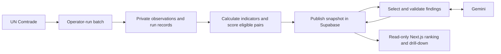

# Publishing a trade research snapshot

**Status** — Operator ingestion, read-only pilot snapshots, and per-product
ranked snapshot publication are implemented. The ranked publisher requires the
full ten-market cohort for a product. A separate operator step adds cached explanations after publication. See the [pilot runbook](vertical-slice.md).

## Write path

1. An operator runs a bounded local batch or manually dispatches a GitHub Action.
   Pin the candidate manifest, HS edition, reference years, and method version.
   Budget calls per run against the actual endpoint and subscription, checkpoint
   completed slices, handle truncation and throttling, and resume across days.
   [UN Comtrade subscription limits](https://comtradeplus.un.org/en/subscriptions)
2. Store source dimensions, flags, original values and retrieval metadata privately.
   Deduplicate repeat retrievals by source key and retain the revision referenced by
   each publication. Each snapshot records its input runs and observation revisions.
3. Precompute annual market totals and growth, supplier ranks/shares and their changes,
   comparable unit values, quality fields, eligibility reasons and score components.
   Persist the candidate cohort, raw component values, weights, threshold settings and
   shortlist cutoff. A published result must be reproducible after a source revision.
4. Publish the ranked snapshot atomically after validating coverage and provenance.
   A failed publication leaves the previous one readable. Carry the snapshot ID from
   the ranking through market detail.
5. In a separate operator step, hash the published evidence including units, period,
   caveats, method and generation version. Reuse accepted findings for that hash
   or ask Gemini to select IDs using transformed categories. Store the accepted
   IDs and a private attempt status. On a miss, failed validation, or a different
   selected range, render a deterministic summary from the snapshot.

## Read path and operating cost

Next.js reads only published summaries through a role with SELECT access to those
results. Keep source payloads, writer credentials and provider keys in the batch
environment. Retire the pilot’s import and live-explanation routes from the public
deployment. Public data reads incur zero Comtrade and Gemini calls.

The green coffee outlook has a dedicated Next.js POST route. It reads published
evidence, checks the private `ai_analyses` cache keyed by normalized evidence,
prompt version and model, then calls Gemini only on an allowed miss. The route
and operator pre-generation use the same service and transactional quota
reservation. Visitors can generate only for the current green coffee release.
Older pinned releases can read saved results. The generation timestamp is
immutable. If generation fails, the service displays a dated previous analysis
or a deterministic outlook. The dashboard's 1.5-second minimum loading display
runs entirely in the browser.

For sizing, 15 products × 10 markets × 5 years × 200 partners is about 150,000
observations before revisions or indexes. Measure database size with representative
payloads, index overhead and retained snapshots before choosing a hosting plan.
Report per-run source calls, rows, eligible pairs, model calls and cache hits.
For new generations, report validated outputs divided by attempted generations,
including failed attempts in the denominator. Report fallback uses separately.

## Transition and acceptance

- Recompute the India HS 854142 pilot with the local snapshot command in the
  [pilot runbook](vertical-slice.md#recompute-a-local-snapshot). Reconcile totals,
  supplier shares and ranks against the working drill-down for matching years.
  Publish the computed pilot through the operator command after applying the migration.
- Add candidate pairs and test exclusion cases before publishing a ranked cohort.
  Record actual batch costs, storage, and claim-tracing results in release evidence.
- Exercise the public ranking, drill-down, quality badges and methodology using
  read-only credentials. Verify retries, unchanged-evidence cache reuse, fallback,
  and continued access to the previous snapshot during an interrupted publication.
